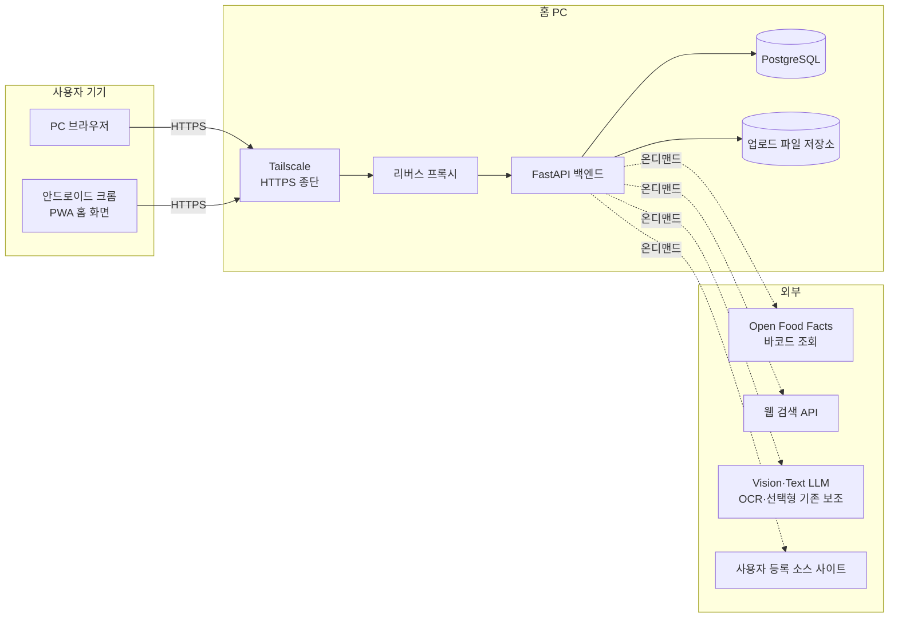
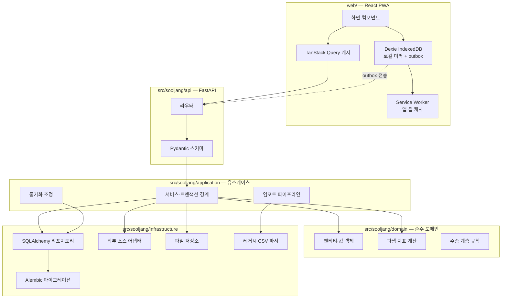
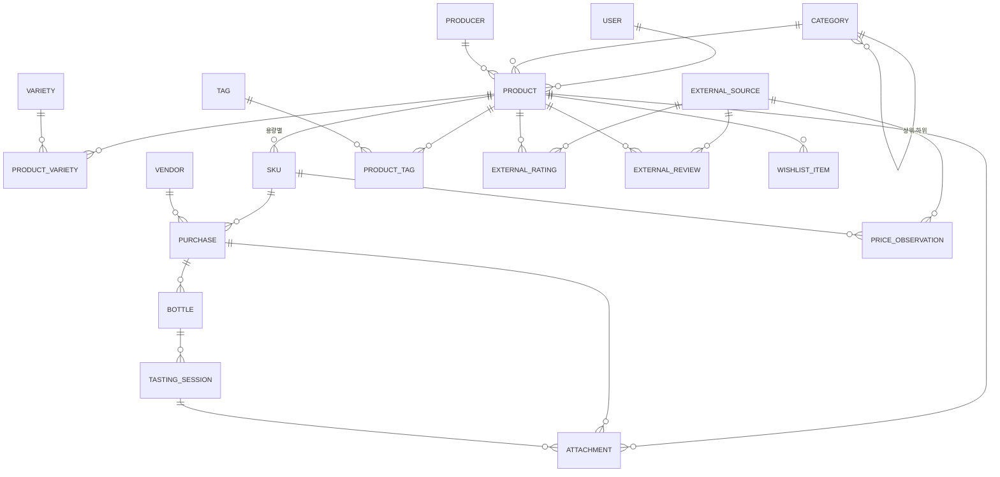
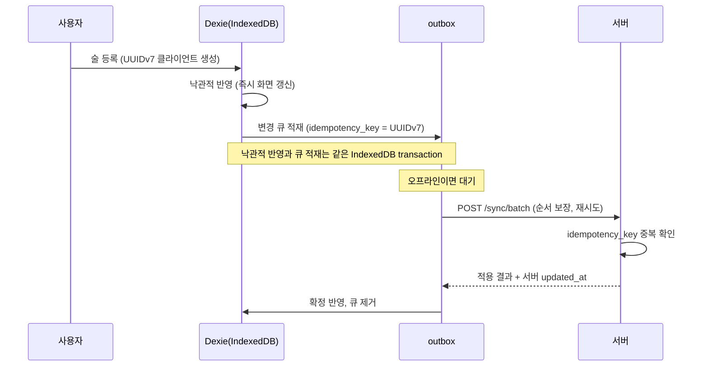
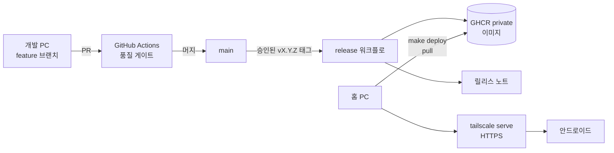

# 술장 아키텍처 설계

이 문서는 구현 전에 결정한 구조와 그 근거를 남긴다. 코드와 어긋나면 문서를 먼저 고친다.
레거시 데이터의 실측 근거는 [legacy-schema.md](legacy-schema.md), 작업 순서와 진행 현황은
[plan.md](plan.md)를 참조한다.

## 1. 시스템 개요

개인이 소유한 주류를 **제품 → 규격 → 구매 건 → 개별 병 → 시음 세션** 계층으로 기록하고,
파생 지표와 통계를 자동 계산하는 단일 사용자 중심 웹 애플리케이션이다. 향후 소수의 지인에게
공유할 수 있도록 처음부터 멀티테넌시를 준비한다.

### 1.1 시스템 컨텍스트



외부 탐색은 사용자가 선택한 연결을 명시적으로 조회하며 생성형 답변·요약을 호출하지 않는다.
가격 감시는 Interest별 정기 조회에 따로 동의한 경우만 제한된 worker가 실행한다. 푸시 수신도
별도 동의다. 요청마다 설정 revision·호스트·실제 호출량을 검사하며 개인 소비 이력을 보내지 않는다.
오프라인에서도 기존 기록·로컬 조회와 입력 복원은 유지되지만 외부 탐색·가격 이력·첨부 원본은
온라인이 필요하다. 상세 계약은 [external-data.md](external-data.md)에 둔다.

### 1.2 컴포넌트 구조



의존 방향은 항상 안쪽(도메인)을 향한다. `domain/`은 SQLAlchemy·FastAPI·HTTP를 import하지
않는다. 파생 지표 계산이 DB 없이 단위 테스트되도록 하기 위한 제약이다.

## 2. 데이터 모델

### 2.1 ERD



### 2.2 공통 컬럼 규약

모든 업무 테이블에 다음을 둔다.

| 컬럼 | 타입 | 목적 |
|---|---|---|
| `id` | `UUID` (UUIDv7) | PK. 시간 정렬성이 있어 인덱스 지역성이 좋고, 오프라인 클라이언트가 서버 왕복 없이 생성할 수 있다 |
| `user_id` | `UUID` FK | 멀티테넌시. 단일 사용자 시기에도 반드시 채운다 |
| `created_at` | `timestamptz` | |
| `updated_at` | `timestamptz` | 동기화 LWW 판정 기준 |
| `deleted_at` | `timestamptz` NULL | soft delete. 삭제를 오프라인 클라이언트에 전파하기 위해 필수 |

조회는 기본적으로 `deleted_at IS NULL` 조건을 적용한다. 동기화 델타 조회만 예외다.

### 2.3 테이블 정의

#### `category` — 주종 (사용자가 관리하는 자기참조 계층)

주종 계층은 **고정 분류가 아니라 사용자 데이터**다. 최상위부터 말단까지 어느 깊이에서든
추가·이름 변경·이동·순서 변경·삭제·병합이 가능하다. 아래 시드는 기존 엑셀에서 도출한
**기본값일 뿐**이며, 사용자가 바꾸면 그 결과가 정답이 된다.

| 컬럼 | 타입 | 제약 |
|---|---|---|
| `parent_id` | `UUID` NULL | 자기참조. NULL이면 최상위 |
| `name` | `text` | `UNIQUE(user_id, parent_id, name) WHERE deleted_at IS NULL` — 같은 부모 아래 이름 중복 금지 |
| `slug` | `text` | 검색·URL용. 이름 변경 시 재생성하되 기존 slug 는 별칭으로 보존 |
| `sort_order` | `int` | 형제 간 표시 순서. 사용자가 지정 |
| `is_seeded` | `bool` | 기본 시드로 생성된 항목인지. UI 에서 "기본값으로 되돌리기"에 사용 |

**깊이 제한을 두지 않는다.** 사용자가 필요한 만큼 세분화할 수 있어야 한다. 대신 다음
불변식을 애플리케이션 계층에서 강제한다.

1. **순환 금지** — 어떤 카테고리도 자기 자신의 조상이 될 수 없다. 이동(`reparent`) 시
   대상이 자신의 후손인지 검사한다
2. **깊이 상한 8** — 순환 방지와 별개로 폭주하는 중첩을 막는 안전장치다. 실용적으로
   도달하지 않는 값이며, 재귀 CTE 성능과 UI 표현을 보호한다
3. **이동 시 후손 동반** — 부모를 바꾸면 서브트리 전체가 함께 이동한다

##### 삭제 정책

카테고리 삭제는 제품을 지우지 않는다. 개인 기록을 잃는 것이 가장 큰 손실이기 때문이다.

| 상황 | 동작 |
|---|---|
| 하위 카테고리가 있음 | 기본은 거부. `?strategy=promote_children` 으로 자식을 삭제 대상의 부모로 승격 후 삭제 |
| 소속 제품이 있음 | 기본은 거부. `?strategy=reassign&target_id=<id>` 로 제품을 다른 카테고리로 옮긴 뒤 삭제 |
| 둘 다 없음 | soft delete |

병합(`POST /categories/{id}:merge`)은 소속 제품과 하위 카테고리를 대상 카테고리로 옮기고
원본을 soft delete 한다. 중복 생성된 카테고리를 정리하는 경로다.

##### 기본 시드 (기존 엑셀에서 도출)

레거시 통계 블록의 롤업에서 도출했다([legacy-schema.md §4.4](legacy-schema.md)). 롤업 병수
합계가 1,078 로 시트 합계행과 일치해 이 구조가 실제 사용 중인 분류임을 확인했다.

```
맥주   (스타일은 variety 로 표현)
와인   ├ 레드와인 · 화이트와인 · 스파클링와인 · 로제와인 · 오렌지와인
       ├ 스위트와인   ├ 토카이와인 · 소테른/바르삭/루피악 와인 · 파시토와인
       │              └ 남아공 스위트와인 · 리브잘트와인 · 아이스와인 · 귀부와인
       └ 주정강화와인 └ 포트와인 · 셰리와인 · 마데이라와인 · 세투발와인
양주   ├ 위스키    └ 싱글몰트 · 블렌디드 · 버번 · 라이 · 블렌디드 몰트 · 그레인
       └ 기타 양주 └ 브랜디 · 럼 · 데낄라 · 메즈칼 · 진 · 보드카 · 리큐르 · 백주
전통주 └ 탁주 · 약주 · 증류주 · 리큐르 · 과실주
사케
미분류 (임포트가 사전에 없는 값을 넣는 자리. 사용자가 옮길 수 있다)
```

임포트는 사전에 없는 `종류` 값을 버리지 않고 `미분류` 아래에 그대로 만든다. 데이터를
조용히 잃는 것보다 사용자가 나중에 옮길 수 있게 보존하는 것이 낫다.

##### 조회

계층 조회는 재귀 CTE(`WITH RECURSIVE`)로 처리한다. "위스키" 필터가 하위 전부를 포함해야
하므로 조상-후손 판정을 매 쿼리에서 수행한다. 데이터 규모(수백~수천 행)에서 재귀 CTE로
충분하고, 병목이 확인되면 closure table 로 전환한다. `depth` 를 컬럼으로 저장하지 않는
이유는 이동이 자유로워 매 이동마다 서브트리 전체를 갱신해야 하고, 그 값이 어긋나면 조회가
조용히 틀리기 때문이다. 깊이는 조회 시 계산한다.

#### `product` — 제품

| 컬럼 | 타입 | 비고 |
|---|---|---|
| `name` | `text` | 표시명. 레거시 이름 첫 줄 |
| `name_en` | `text` NULL | 원어명 |
| `search_aliases` | `jsonb` NOT NULL | 사용자가 확인한 검색 별칭, 최대 20개·각 300자. schema 0021 |
| `category_id` | `UUID` FK | |
| `producer_id` | `UUID` FK NULL | |
| `country`, `region` | `text` NULL | |
| `abv` | `numeric(5,2)` NULL | `CHECK (abv >= 0 AND abv <= 100)` |
| `vintage` | `int` NULL | `CHECK (vintage BETWEEN 1800 AND 2200)` |
| `age_years` | `numeric(4,1)` NULL | 숙성 연수 |
| `note` | `text` NULL | 제품 메모. 레거시 `느낀 점`·이름 2번째 줄 이관 |
| `personal_rating` | `numeric(3,1)` NULL | `CHECK (0 < r <= 6)` — 레거시가 6점 만점 |

`personal_rating`은 제품 수준 총평이다. 시음 세션별 평점과 별개로 두어 레거시 데이터를 손실 없이
받고, 세션이 쌓이면 세션 평균을 함께 보여준다.

중복 판정 키: `(user_id, normalized_name, vintage, abv)`. `normalized_name`은 공백·대소문자·
전각문자·구두점을 정규화한 값이다.

#### `sku` — 규격 (용량별 단위)

| 컬럼 | 타입 | 비고 |
|---|---|---|
| `product_id` | `UUID` FK | |
| `volume_ml` | `int` | `CHECK (volume_ml > 0)` |
| `barcode` | `text` NULL | `UNIQUE(user_id, barcode) WHERE barcode IS NOT NULL` |
| `barcode_type` | `enum` NULL | `ean13`/`upca`/`ean8`/`other` |
| `package_note` | `text` NULL | 선물세트 등 |

`UNIQUE(product_id, volume_ml)`. 같은 술의 700ml와 1L을 구분하고, 바코드 매칭·100ml당 가격
계산의 단위가 된다.

#### `vendor` — 구매처

| 컬럼 | 타입 | 비고 |
|---|---|---|
| `name` | `text` | `UNIQUE(user_id, name)` |
| `kind` | `enum` | `mart`/`online`/`duty_free`/`bottle_shop`/`bar`/`event`/`gift`/`other` |
| `url` | `text` NULL | |
| `note` | `text` NULL | |

레거시에서 82개가 추출된다. `카카오톡 선물하기`·`회사선물`·`시윤이의 선물`은 `gift`,
`신라 온라인 면세`는 `duty_free`, `2024 수원 메가쇼`류는 `event`로 매핑한다.

#### `purchase` — 구매 건

| 컬럼 | 타입 | 비고 |
|---|---|---|
| `sku_id` | `UUID` FK | |
| `vendor_id` | `UUID` FK NULL | |
| `purchased_on` | `date` NULL | 레거시에 없어 NULL 허용 |
| `quantity` | `int` | `CHECK (quantity > 0)` |
| `unit_list_price` | `numeric(14,2)` NULL | **병당** 정가 (원화), 공란/NULL은 0원 |
| `unit_paid_price` | `numeric(14,2)` NULL | **병당** 실지불가 (원화), 공란/NULL은 0원 |
| `currency` | `char(3)` | 기본 `KRW` |
| `fx_rate` | `numeric(14,6)` NULL | 구매 시점 환율 스냅샷 |
| `foreign_unit_price` | `numeric(14,2)` NULL | 외화 표시 병당 가격 |
| `discount_note` | `text` NULL | `1+1`, `수원페이 10%` 등 원문 |
| `import_note` | `text` NULL | 레거시 원문 보존 (분할 실패한 구매처 문자열 등) |

레거시는 총액을 저장했지만([legacy-schema.md §4.2](legacy-schema.md)) DB는 **병당 단가**를
저장한다. 총액은 `unit_price × quantity`로 언제든 복원되고, 구매 건을 쪼갤 때 단가가 보존되어야
하기 때문이다. 임포트 시 `총액 ÷ 병수`로 변환한다.

외화 구매는 `foreign_unit_price × fx_rate`를 `unit_paid_price`에 저장하고 원시값도 함께 남겨
사후 검증이 가능하게 한다. 환율은 **구매 시점 값으로 고정**한다. 현재 환율로 재평가하면 과거
지출액이 매일 바뀌어 통계가 재현되지 않는다.

#### `bottle` — 개별 병

| 컬럼 | 타입 | 비고 |
|---|---|---|
| `purchase_id` | `UUID` FK | |
| `status` | `enum` | `unopened`/`open`/`finished`/`gifted`/`sold` |
| `opened_on` | `date` NULL | |
| `finished_on` | `date` NULL | |
| `remaining_ml` | `int` NULL | 미개봉의 NULL은 SKU 전량, 개봉의 NULL은 잔량 미기록 |
| `revision` | `UUID` NOT NULL | 병 변경마다 교체하는 동시성 토큰. schema 0020 |
| `storage_location` | `text` NULL | |
| `label_no` | `int` | 구매 건 내 순번. `UNIQUE(purchase_id, label_no)` |

제약: `status='unopened'`면 `opened_on IS NULL`, `status='finished'`면 `remaining_ml = 0`,
`remaining_ml <= sku.volume_ml` (애플리케이션 계층 검증. 크로스 테이블이라 DB CHECK로 표현 불가).

구매 건 저장 시 `quantity`만큼 `bottle` 행을 자동 생성한다. 레거시 임포트는 `소비` 병수만큼
`finished`, `미개봉`만큼 `unopened`, `개봉`만큼 `open`으로 초기화한다.
수량 수정은 구매 행을 잠근 뒤 처리한다. 줄일 때는 번호가 큰 미개봉 병부터 soft delete하고,
다시 늘릴 때는 삭제된 병까지 포함한 최대 번호 다음부터 생성해 기존 병 ID·시음을 보존한다.
구매 분할은 명시한 구매처와 상속할 구매처의 소유권·삭제 여부를 모두 검증한다. 기존에
잘못 연결된 타 계정 구매처의 이름도 구매 조회 응답에 노출하지 않는다.

#### `tasting_session` — 시음 세션

| 컬럼 | 타입 | 비고 |
|---|---|---|
| `bottle_id` | `UUID` FK NULL | 내 병에서 마신 경우에만 연결 |
| `sku_id` | `UUID` FK | 시음한 규격 |
| `tasted_on` | `date` | 마신 날 |
| `poured_ml` | `int` NULL | 기록 시 연결된 병의 `remaining_ml` 차감 |
| `rating` | `numeric(3,1)` NULL | `CHECK (0 <= rating <= 6)`, 0.5 단위 |
| `nose`, `palate`, `finish` | `text` NULL | |
| `note` | `text` NULL | |
| `companions`, `place` | `text` NULL | |

#### 외부 소스·평점·관심·판매 관측

현재 계약은 [external-data.md](external-data.md) §2~3에 모은다. `external_source`는
`adapter_spec`, 적용 `category_id`, `connection_id`, `is_active`, 호출 제한·검증 revision을
저장한다. 검색은 별도의 `provider_connection`과 `discovery` API를 사용하며 `strategy=search`
컬럼이나 검색 결과를 LLM으로 요약하는 경로는 없다.

제품별 사용자 고정은 `external_product_match`, 일회성 결과 캐시는 `external_lookup_cache`,
허용된 판매 조건·관측은 `external_offer`와 `external_price_observation`에 저장한다.
레거시 원문 보존·이관 규칙은 [legacy-schema.md](legacy-schema.md)를 따른다. 옛 설계의 `external_rating`/`external_review`/
`price_observation` 3테이블과 모든 원문·요약의 영구 저장은 현재 구현이 아니다.

#### 그 외

- `producer`, `variety`, `product_variety`, `tag`, `product_tag`: 단순 참조·연결 테이블
- `attachment`: `product_id`/`bottle_id`/`tasting_session_id` 중 정확히 하나만 채우는 3개
  nullable FK 로 소유자를 표현한다(CHECK 제약으로 강제) — 다형 `owner_type`/`owner_id`
  컬럼 하나 대신 이 방식을 쓴 이유는 FK 제약을 그대로 걸 수 있어서다(다형 참조는 DB 가
  참조 무결성을 검사할 수 없다). `kind`(`label`/`tasting`/`bottle`/`other`), `content_type`,
  `byte_size`, `sha256`, `storage_path`. 업로드는 `POST /attachments`(Task 17) 가 이미지만
  받는다
- `interest`: 비보유 관심 대상. 구매·재고와 분리된 UUID, identity·사용자 별칭·메모·선택 출처
  URL(`reference_urls`, schema 0021)을 보존한다. 삭제/복구와 감시 경계는 external-data §3.5.
- `saved_view`: 커스텀 피벗 정의(Task 20). `name`, `definition jsonb`(검증하지 않는다 —
  불러와 `POST /stats/pivot` 에 다시 보낼 때 그 스키마가 검증한다). `EntityMixin` 을
  쓰지만 **동기화 대상이 아니다**. 서버 피벗과 저장된 뷰는 온라인 전용이다. 기본 통계
  인사이트·홈의 보유 집계는 로컬 미러에서 계산하므로 오프라인에서도 사용할 수 있다
- `sync_cursor`, `outbox_receipt`, `conflict_log`: 동기화 상태(§5). `conflict_log` 는
  LWW 충돌에서 진 로컬 변경을 보관한다(§5.4) — 다른 9개 동기화 대상 테이블과 같은
  공통 컬럼(`EntityMixin`)을 써서 풀 대상에 포함시킨다. 한 기기의 충돌이 다른 기기의
  로컬 미러에도 같은 배관으로 전파된다
- `llm_setting`: LLM 제공자·모델·API 키(Task 17). `EntityMixin` 을 쓰지만 **동기화 대상이
  아니다** — `SYNC_ENTITIES` 레지스트리에 의도적으로 넣지 않는다. API 키가 클라이언트
  IndexedDB 로 미러링되면 안 된다. 키는 평문이 아니라 Fernet 암호문(`api_key_ciphertext`)
  으로 저장하고, 화면에 마스킹 값을 보여주기 위한 마지막 4자만 별도 평문 컬럼
  (`api_key_hint`)으로 둔다
- `external_source`: 사용자가 등록한 조회 대상 사이트 하나(Task 18, §7). `name`,
  `base_url`, `adapter_spec jsonb`(§7.2 스키마), `category_id`(FK, `NULL` 이면 전역 소스),
  `priority`, `is_active`, `rate_limit_per_min`, `ttl_hours`. `llm_setting` 과 같은 이유로
  동기화 대상이 아니다. 검색 제공자 연결과 허용된 소스 adapter를 별도로 관리한다
- `external_lookup_cache`: 소스·제품별 최근 조회 결과(§7.1 `FetchedSnapshot`). `source_id`,
  `product_id`, `snapshot jsonb`(`source_url`/`fields`/`raw_excerpt`), `degraded`,
  `warning`, `fetched_at`. `ttl_hours` 내 재조회 요청은 이 값을 그대로 돌려준다(§7.3).
  `source_url` 없는 결과는 저장하지 않는다(§7.1 절대 규칙) — 동기화 대상이 아니다
- `user`, `session`: 인증(§6)
- `storage_location`, `bottle_placement`, `bottle_movement`, `stocktake`, `cleanup_preview`:
  보관 위치·병 배치·이동 이력·재고 실사·정리 미리보기(v1.7.0). 온라인 전용이며 동기화 대상이
  아니다. 실사 관찰은 `stocktake.observations` JSONB에 둔다(개인 규모라 행 재작성 비용이 작다, D218)
- `record_event`(0019, v1.8.0): 병 상태 전이·잔량 조정·시음으로 인한 병 변화와 구매 수정의
  변경 이력. v1.8.2부터 실사 관찰 정정도 기록한다. `entity`(`bottle`|`purchase`|`stocktake`),
  `entity_id`, `action`, `detail jsonb`(바뀐 칸의
  [이전, 이후]). 재계산할 수 없는 1차 사실이라 저장한다. 동기화 대상이 아니며 과거 이력은
  소급하지 않는다(D222). 구매처·보관 위치는 id로 남기고, 이력 API가 읽을 때 지금 이름을
  `labels`로 붙인다(D225). v1.9.0 정정은 `tasting_session` 이벤트와
  `{request_id, before, after}` 스냅샷을 추가로 기록하며, 미사용 SKU 복원은 `sku` 이벤트로 남긴다
- 외부 연결·탐색·관심·가격 감시 테이블(`provider_connection`, `interest`, `external_offer`,
  `price_watch` 등)은 [external-data.md](external-data.md)를 본다

### 날짜와 시간대

"오늘"로 채우는 날짜(개봉·소진·증여·판매·시음·구매 기본값)는 사용자 시간대 기준이다. 웹은
기기 시간대(`format.todayLocal`), 서버는 `SOOLJANG_TIMEZONE`(기본 Asia/Seoul, `clock.local_today`)을
쓴다. 컨테이너 UTC를 그대로 쓰면 한국 00~09시 기록이 전날로 저장된다(D212). 타임스탬프 컬럼은
UTC `timestamptz`다.

### 2.4 인덱스

| 대상 | 인덱스 |
|---|---|
| 이름 부분 문자열 인덱스 | `GIN (name gin_trgm_ops)` on `product`; 한영·초성 q 필터는 아래 공통 검색 규칙 사용 |
| 목록 기본 정렬·필터 | `(user_id, deleted_at, category_id)` on `product` |
| 동기화 델타 | `(user_id, updated_at)` on 모든 동기화 대상 테이블 |
| 바코드 조회 | `UNIQUE (user_id, barcode) WHERE barcode IS NOT NULL` on `sku` |
| 집계 | `(sku_id)` on `purchase`, `(purchase_id, status)` on `bottle` |
| 시세 시계열 | `(sku_id, source_id, observed_at DESC)` on `price_observation` |

## 3. 파생 지표 계산 규칙

모두 계산 필드다. 저장하지 않는다. 저장하면 엑셀과 같은 불일치 문제가 재발한다.

기호: 제품 `p`, 규격 `s`, 구매 건 집합 `P`, 병 집합 `B`.

| 지표 | 정의 |
|---|---|
| 구매 병수 | `Σ_{i∈P} quantity_i` |
| 소비 병수 | `|{b∈B : status(b) = finished}|` |
| 증여·판매 병수 | `|{b∈B : status(b) ∈ {gifted, sold}}|` |
| 미개봉 병수 | `|{b∈B : status(b) = unopened}|` |
| 개봉 병수 | `|{b∈B : status(b) = open}|` |
| 재고 병수 | `미개봉 + 개봉` |
| 평단가 (`avg_list_price`) | `Σ(unit_list_price_i × quantity_i) / Σ quantity_i` |
| 실평단가 (`avg_paid_price`) | `Σ(unit_paid_price_i × quantity_i) / Σ quantity_i` |
| 100ml당 가격 | `avg_list_price / (volume_ml / 100)` — **정가 기준** |
| 100ml당 실가격 | `avg_paid_price / (volume_ml / 100)` — 신규 지표 |
| 할인율 | `1 − (Σ unit_paid × qty) / (Σ unit_list × qty)` — 정가가 기록된(0원 초과) 구매만(D215) |
| 재고 자산가치(원가) | `Σ_{b∈재고} avg_paid_price(sku(b))` |
| 재고 자산가치(시세) | `Σ_{b∈재고} latest_price_observation(sku(b))`, 관측 없으면 원가로 대체 |
| 개봉 후 소진 기간 | `finished_on − opened_on` (일) |
| 소비 속도 | 기간 내 `finished` 병 수 / 기간(월) |
| 가성비 | `rating / price_per_100ml` (높을수록 좋음) |

100ml당 가격이 **정가 기준**인 것은 레거시 통계와 일치시키기 위한 결정이다
([legacy-schema.md §4.2](legacy-schema.md), 391건 일치·불일치 0으로 검증). 실구매 기준 지표는
`price_per_100ml_paid`로 별도 제공한다.

여러 용량이 섞인 제품의 제품 수준 100ml당 가격은 **가중 평균**으로 계산한다:
`Σ(unit_list × qty) / Σ(volume_ml × qty / 100)`.

구매 정가·실구매가 공란/NULL은 선물·포인트 구매 등의 0원이다(2026-09-07 사용자 정정, D211).
제품별·전체 평균의 분모에 해당 병수와 용량을 포함한다. 구매 자체가 없거나 분모가 0인
지표만 미정의로 남긴다. 다만 **할인율**은 정가 0원을 기준으로 삼을 수 없어 정가가 기록된
구매만으로 계산하고, **가격 순위**(병당·총액·100ml당)에는 0원 제품을 넣지 않는다(D215).

제품 수준 지표는 여러 용량(규격)을 섞은 값이다. 제품 상세의 "용량별" 표는 같은 규칙을
규격마다 따로 적용해 보여준다. 목록은 제품 한 항목 아래 규격별 재고·실평단가를 표시한다.
현재 재고가 있는 규격부터 용량순으로 보여주고, 소진 규격과 구매 없는 규격을 구분한다.

규격 원가는 중간 평균을 반올림하지 않고 `SKU 실구매 총액 / SKU 구매 병수 × SKU 재고 병수`를
계산한 뒤 소수 2자리 HALF_UP으로 확정한다. 제품·전체 원가는 확정한 SKU 원가의 합이다.
병당 원가이므로 남은 ml 비율을 곱하지 않는다. G05의 70,000원/3병×재고2병은 46,666.67원이다.
도메인·SQL·IndexedDB가 같은 합성 정답을 사용한다.

구매처·구매일·용량 조건은 **같은 구매 건**에서 AND로 만족해야 한다. 가격 필터·정렬의
모집단은 조건에 맞는 구매이며, 전체 재고 원가와 별도 값으로 제공한다. 재고 조건은 해당
구매에 속한 병을 확인한다. 0원 구매를 포함하고 구매 없는 null 가격은 정렬 방향과 무관하게
뒤에 둔다. 매장 최근/최저/평균과 외부 제안의 비교 기준은 선택한 SKU의 실구매가다.

계산은 `domain/metrics.py`의 순수 함수로 구현하고, 목록·통계 조회 성능이 필요한 경로는 동일
공식을 SQL 뷰로 이중 구현한다. **두 구현이 같은 결과를 내는지 검증하는 테스트를 둔다.**

## 4. API 설계

### 4.1 규약

- 베이스 경로 `/api/v1`
- 리소스 중심 URL, 동사는 HTTP 메서드로 표현. 상태 전이 등 예외는 `POST /bottles/{id}:open` 형태
- 요청·응답 본문은 `snake_case` JSON
- 동기화 배치(`POST /sync/batch`)의 각 작업은 본문의 `idempotency_key` 필드로 재전송
  중복을 막는다(§5.2). 배치 하나에 작업이 여러 개 들어가므로 요청당 값 하나뿐인 HTTP
  헤더로는 표현할 수 없다 — 애초에 outbox 는 일반 CRUD 엔드포인트를 직접 부르지 않고
  전부 `/sync/batch` 로 모이므로, 다른 엔드포인트에 범용 `Idempotency-Key` 헤더를 따로
  둘 이유가 없다(Task 15, 코드와 어긋난 이전 문구를 정정)
- 온라인 전용 생성(`POST /products`, `POST /purchases`)은 본문의 선택 `request_id`로 응답
  유실 후 재전송을 같은 행으로 돌려준다. 서버가 `uuid5(user_id, 종류:request_id)`로 id를 정하고,
  같은 키에 다른 이름·규격·병수가 오면 409다. 웹은 폼 초안 버전의 해시를 키로 쓴다(D249)
- 쓰기 응답은 요청 세션 commit 뒤에만 나간다(`db_session`의 `scope="function"`). commit이
  실패하면 5xx이므로 클라이언트가 성공으로 오인해 대기열·초안을 지우지 않는다(D249)
- 에러는 RFC 9457 Problem Details

```json
{ "type": "https://sooljang.local/errors/validation",
  "title": "요청 값이 올바르지 않습니다",
  "status": 422,
  "detail": "remaining_ml 은 규격 용량을 초과할 수 없습니다",
  "errors": [{ "field": "remaining_ml", "code": "exceeds_volume" }] }
```

- 커서 목록은 `?limit=50&cursor=<opaque>` → `{ "items": [...],
  "next_cursor": "..." }`. offset 방식은 데이터가 바뀌면 중복·누락이 생겨 무한 스크롤에
  부적합하다
- 정렬은 `?sort=price_per_100ml&order=asc`. 정렬 키에는 항상 `id`를 tie-breaker로 추가해
  커서 안정성을 보장한다

### 4.2 엔드포인트

아래 표는 v1.10.0 구현 API다(`/api/v1` 접두사 생략). health·auth를 뺀 모든 경로는
라우터 단위로 인증을 요구하고(§6), 사용자 데이터는 소유권을 검사한다. 외부 연결·탐색·가격
감시 경로의 동작은 [external-data.md](external-data.md)를 본다.

| 영역 | 메서드 · 경로 | 설명 |
|---|---|---|
| attachments | `GET /attachments` | List Product Attachments |
| attachments | `POST /attachments` | Upload Attachment |
| attachments | `GET /attachments/{attachment_id}/content` | Attachment Content |
| auth | `POST /auth/login` | 로그인 |
| auth | `POST /auth/logout` | 로그아웃 |
| auth | `GET /auth/me` | 현재 사용자 |
| auth | `PATCH /auth/me` | 표시 이름 수정 |
| auth | `POST /auth/password` | 비밀번호 변경 (다른 세션 전부 폐기) |
| auth | `GET /auth/setup` | 초기 설정 필요 여부 |
| auth | `POST /auth/setup` | 최초 사용자 생성 |
| barcodes | `GET /barcodes/{code}` | 바코드 조회 (로컬 → 외부) |
| bottles | `GET /bottles` | 병 목록 |
| bottles | `GET /bottles/{bottle_id}` | 병 조회 |
| bottles | `GET /bottles/{bottle_id}/history` | 병 변경 이력 |
| bottles | `GET /bottles/{bottle_id}/correction-context` | 정정용 최신 병·규격·구매 버전 |
| bottles | `GET /bottles/{bottle_id}/tastings` | 병의 최근 시음 50건, 기존 배열 응답 유지 |
| bottles | `GET /bottles/{bottle_id}/tastings/page` | 커서로 오래된 시음까지 이어 보기 |
| bottles | `POST /bottles/{bottle_id}:finish` | 소진 |
| bottles | `POST /bottles/{bottle_id}:gift` | 증여 |
| bottles | `POST /bottles/{bottle_id}:open` | 개봉 |
| bottles | `POST /bottles/{bottle_id}:remaining` | 잔량 조정 |
| bottles | `POST /bottles/{bottle_id}:reopen` | 상태 되돌리기 |
| bottles | `POST /bottles/{bottle_id}:sell` | 판매 |
| bottles | `POST /bottles/{bottle_id}:unopen` | 개봉 취소 |
| categories | `GET /categories` | 주종 계층 전체 조회 |
| categories | `POST /categories` | 주종 추가 |
| categories | `DELETE /categories/{category_id}` | 주종 삭제 |
| categories | `PATCH /categories/{category_id}` | 주종 수정 |
| categories | `POST /categories/{category_id}:merge` | 주종 병합 |
| categories | `POST /categories/{category_id}:reparent` | 주종 이동 |
| categories | `POST /categories:reorder` | 표시 순서 일괄 변경 |
| categories | `POST /categories:reset-seed` | 기본 주종 복원 |
| categories | `POST /categories:save-as-default` | 현재 구조를 기본으로 저장 |
| collection | `GET /collection/bottles` | Bottles |
| collection | `PUT /collection/bottles/{bottle_id}/location` | Place |
| collection | `GET /collection/bottles/{bottle_id}/movements` | Movements |
| collection | `PUT /collection/bottles:move` | Place Many |
| collection | `GET /collection/cleanup/history` | Cleanup History |
| collection | `POST /collection/cleanup/preview` | Preview |
| collection | `POST /collection/cleanup/{preview_id}/confirm` | Confirm |
| collection | `GET /collection/locations` | Locations |
| collection | `POST /collection/locations` | Create Location |
| collection | `PATCH /collection/locations/{location_id}` | Update Location |
| collection | `GET /collection/quality` | Quality |
| collection | `GET /collection/stocktakes` | Stocktakes |
| collection | `POST /collection/stocktakes` | Create Stocktake |
| collection | `PATCH /collection/stocktakes/{stocktake_id}` | Update Stocktake |
| collection | `POST /collection/stocktakes/{stocktake_id}/found` | Found |
| collection | `POST /collection/stocktakes/{stocktake_id}/scan` | Scan |
| collection | `PATCH /collection/stocktakes/{stocktake_id}/observations/{bottle_id}` | 실사 관찰 위치 정정 |
| collection | `POST /collection/stocktakes/{stocktake_id}:apply-locations` | Apply Locations |
| connections | `GET /connections` | List Connections |
| connections | `POST /connections` | Register Connection |
| connections | `GET /connections/providers` | Providers |
| connections | `DELETE /connections/{connection_id}` | Disconnect |
| connections | `GET /connections/{connection_id}` | Read Connection |
| connections | `PATCH /connections/{connection_id}` | Edit Connection |
| connections | `POST /connections/{connection_id}/probe` | Test Connection |
| connections | `PUT /connections/{connection_id}/sources/{source_id}` | Share Connection |
| discovery | `POST /discovery/apply` | Apply |
| discovery | `POST /discovery/interests/{interest_id}/lookup` | Interest Lookup |
| discovery | `POST /discovery/lookup` | Lookup |
| discovery | `GET /discovery/products/{product_id}/context` | Product Context |
| discovery | `POST /discovery/products/{product_id}/lookup` | Product Lookup |
| discovery | `POST /discovery/search` | Search |
| external-sources | `GET /external-sources` | 외부 소스 목록 |
| external-sources | `POST /external-sources` | 외부 소스 등록 |
| external-sources | `GET /external-sources/health` | 소스별 최근 조회 이력 요약 |
| external-sources | `GET /external-sources/presets` | 번들 소스 프리셋 카탈로그 |
| external-sources | `DELETE /external-sources/{source_id}` | 외부 소스 삭제 |
| external-sources | `PATCH /external-sources/{source_id}` | 외부 소스 수정 |
| external-sources | `PUT /external-sources/{source_id}/credentials` | 소스에 필요한 자격 증명을 일괄 저장(암호화) |
| external-sources | `POST /external-sources/{source_id}/probe` | 샘플 제품명으로 소스를 테스트 조회(캐시에 저장하지 않음) |
| external-sources | `POST /products/{product_id}/external-lookup` | 제품에 대해 등록된 외부 소스를 조회 |
| external-sources | `POST /products/{product_id}/external-matches` | 제품과 외부 소스 상품의 매칭을 고정 |
| external-sources | `DELETE /products/{product_id}/external-matches/{source_id}` | 매칭 고정 해제 |
| health | `GET /health` | 서비스 상태 확인 |
| health | `GET /health/live` | 프로세스 생존 확인 |
| health | `GET /health/ready` | 서비스 준비 상태 확인 |
| imports | `POST /imports/legacy:analyze` | 레거시 시트 분석 (dry-run) |
| imports | `POST /imports/legacy:commit` | 레거시 시트 적재 |
| interests | `GET /interests` | List Interests |
| interests | `POST /interests` | Post Interest |
| interests | `PATCH /interests/{interest_id}` | Patch Interest |
| interests | `DELETE /interests/{interest_id}` | 조회 버전 검사 후 소프트 삭제, 갱신된 관심 반환 |
| interests | `POST /interests/{interest_id}/restore` | 삭제 버전 검사 후 같은 ID 복구, 감시는 중지 유지 |
| interests | `POST /interests/{interest_id}/purchase` | Purchase Interest |
| llm-settings | `DELETE /llm-settings` | Remove Llm Setting |
| llm-settings | `GET /llm-settings` | Read Llm Setting |
| llm-settings | `PUT /llm-settings` | Upsert Llm Setting |
| ocr | `POST /ocr/label` | Extract Label Fields |
| price-watch | `GET /price-watch` | Watches |
| price-watch | `POST /price-watch` | Create |
| price-watch | `GET /price-watch/config` | Configuration |
| price-watch | `GET /price-watch/interests/{interest_id}/history` | History |
| price-watch | `GET /price-watch/notifications` | Notifications |
| price-watch | `POST /price-watch/notifications/{notification_id}/read` | Mark Read |
| price-watch | `GET /price-watch/products/{product_id}/history` | Product History |
| price-watch | `GET /price-watch/runs/{run_id}` | Read Run |
| price-watch | `GET /price-watch/subscriptions` | Subscriptions |
| price-watch | `POST /price-watch/subscriptions` | Subscribe |
| price-watch | `DELETE /price-watch/subscriptions/{subscription_id}` | Unsubscribe |
| price-watch | `DELETE /price-watch/{watch_id}` | Remove |
| price-watch | `PATCH /price-watch/{watch_id}` | Edit |
| price-watch | `POST /price-watch/{watch_id}/check` | Check |
| products | `GET /products` | 제품 목록 조회 |
| products | `POST /products` | 제품 등록 |
| products | `DELETE /products/{product_id}` | 제품 삭제 (soft delete) |
| products | `GET /products/{product_id}` | 제품 상세 조회 |
| products | `PATCH /products/{product_id}` | 제품 수정 |
| products | `GET /products/{product_id}/metrics` | 파생 지표만 조회 |
| products | `POST /products/{product_id}/skus` | 규격 추가 |
| products | `PATCH /skus/{sku_id}` | 규격 수정. 사용 이력이 있으면 용량 변경 거부 |
| products | `DELETE /skus/{sku_id}` | 미사용 규격만 삭제 |
| purchases | `GET /purchases` | 구매 건 목록 |
| purchases | `POST /purchases` | 구매 건 등록 |
| purchases | `DELETE /purchases/{purchase_id}` | 구매 건 삭제 |
| purchases | `PATCH /purchases/{purchase_id}` | 구매 건 수정 |
| purchases | `GET /purchases/{purchase_id}/bottles` | 구매 건의 병 목록 |
| purchases | `GET /purchases/{purchase_id}/history` | 구매 건 변경 이력 |
| purchases | `POST /purchases/{purchase_id}:split` | 구매 건 분할 |
| purchases | `GET /purchases/{purchase_id}/correction-context` | 삭제된 자식까지 포함한 정정 전제조건 |
| purchases | `POST /purchases/{purchase_id}:correct-sku` | ID·현재 상태를 보존하는 구매 규격 정정 |
| saved-views | `GET /saved-views` | 저장된 뷰 목록 |
| saved-views | `POST /saved-views` | 뷰 저장 |
| saved-views | `DELETE /saved-views/{view_id}` | 뷰 삭제 |
| saved-views | `PATCH /saved-views/{view_id}` | 뷰 이름·정의 수정 |
| stats | `GET /stats/by-category` | 주종별 집계 |
| stats | `POST /stats/pivot` | 커스텀 피벗 (Task 20) |
| stats | `GET /stats/rankings` | 랭킹 4종 |
| stats | `GET /stats/summary` | 전체 합계 |
| stats | `GET /stats/timeseries` | 월별 지출·구매 병수 |
| sync | `GET /sync` | 델타 풀 |
| sync | `POST /sync/batch` | outbox 일괄 전송 |
| sync | `POST /sync/conflicts/{conflict_id}:resolve` | 충돌 확인 처리 |
| tastings | `GET /tastings` | 시음 타임라인 |
| tastings | `POST /tastings` | 시음 기록 |
| tastings | `GET /tastings/summary` | 제품·규격·병·기간별 시음 요약 |
| tastings | `GET /tastings/page` | 맥락을 포함한 전체 커서 조회 |
| tastings | `GET /tastings/{tasting_id}` | 시음과 판본·규격·병·구매 맥락 |
| tastings | `GET /tastings/{tasting_id}/attachments` | 시음 첨부 |
| tastings | `GET /tastings/{tasting_id}/history` | 시음 정정 이력 |
| tastings | `POST /tastings/{tasting_id}:correct` | 기록만 정정 또는 양쪽 병 최종 상태 명시 |
| tastings | `DELETE /tastings/{tasting_id}` | `request_id`·`expected_updated_at`을 검증한 기록 삭제. 200에 최신 버전 반환 |
| tastings | `POST /tastings/{tasting_id}:restore` | 같은 ID·첨부·내용 복구, 현재 잔량은 그대로 |
| vendors | `GET /vendors` | 구매처 목록 |
| vendors | `POST /vendors` | 구매처 등록 |
| vendors | `DELETE /vendors/{vendor_id}` | 구매처 삭제 |
| vendors | `PATCH /vendors/{vendor_id}` | 구매처 수정 |
| vendors | `POST /vendors/{vendor_id}:merge` | 구매처 병합 |

병 시음 `/tastings/page`는 `{items, next_cursor}`를 반환하며 `limit`은 기본 50, 최대 200이다.
`(tasted_on, id)` 내림차순 커서로 같은 날의 기록도 빠짐없이 이어 읽는다. 웹은 이미 읽은
내역을 추가 조회 실패 때도 유지하고 재시도를 제공한다. 기존 배열 API는 그대로 지원한다.

실사 관찰 PATCH의 `observed_location_id`와 `expected_observed_location_id`는 모두 필수이며
`null` 또는 UUID다. active 실사의 `checked`·`unexpected`·`location_mismatch` 관찰만 정정한다.
최초 `recorded_location_id`를 보존해 결과·집계를 다시 계산하고, 실제 병 위치·재고는 바꾸지
않는다. 현재 관찰이 이미 원하는 값이면 재시도도 200, 예상 이전값과 다르면 409다. 완료·위치
반영 후 정정은 409, 존재하지 않거나 삭제된 대상·타 계정 참조는 404로 거절한다. 응답은 갱신된
실사 전체다. 스캔·정정·위치 반영·삭제는 위치 → 실사 → 병 → 배치 순서로 필요한 행을 잠그며,
잠금 사이 대상이 바뀌면 재검증한다.

### 4.3 필터 규약

`GET /products` 필터: `category_id`(하위 포함), `country`, `abv_min`/`abv_max`,
`price_per_100ml_min`/`_max`, `in_stock`(bool), `rating_min`, `vendor_id`, `variety`,
`q`(한영 별칭·초성·Unicode 정규화 부분 검색), `vintage_min`/`_max`, `volume_ml`,
`purchased_on_min`/`purchased_on_max`. 모두 AND로 결합한다. 구매처·날짜·용량은 같은 구매 건에서
만족해야 하며, 선택 조건의 가격·재고와 제품 전체 지표를 별도 필드로 제공한다.

검색은 `domain/search.py`와 `web/src/search.ts`가 같은 사전·120개 합성 정답을 사용한다.
브랜드 사전은 `domain/search_aliases.json`에서 출처·확인일·범위를 관리한다. 표시명·원어명·
사용자 별칭은 검색에만 연결하며 중복 키·빈티지·숙성·SKU는 바꾸지 않는다. 모르는 한영 이름을
자동 음역하지 않는다. 외부 검색어는 브랜드 구간만 치환해 원래 판본·용량 단위를 보존한다.

### 4.4 기록 탐색과 정정

`GET /tastings/page`는 제품·규격·병·기간 필터와 커서, 판본·구매 맥락을 제공한다.
REST 시음 응답의 맥락 필드는 추가형이며 sync 원본 DTO는 유지한다. 제품/구매/규격이 삭제된
자식은 원본을 보존하면서 조회에서 숨긴다. 첫 조회·추가 조회·갱신 실패에도 읽은 목록을 남긴다.
홈 최근 시음도 같은 소유권·유효 부모 검사와 날짜/ID 내림차순을 사용한다. 같은 날 새로
기록한 시음이 오래된 기록 뒤에 밀리거나 삭제된 구매의 시음이 다시 나타나지 않는다.

`POST /tastings/{id}:correct`와 `/purchases/{id}:correct-sku`는 online 전용이다.
사용자·부모·영향받는 병을 잠그고 원본 시음 시각·병 revision·SKU 용량·자식 집합을 검사한다.
시음 정정은 현재 상태·잔량 유지가 기본이며 `set_final`에서만 영향받는 양쪽 병의 최종값을
함께 적용한다. 양을 바꾸거나 기록을 삭제했다고 과거 차감량을 자동 복원하지 않는다.
구매 정정은 삭제된 자식도 버전 검사에 포함하고 ID·시음·첨부·QR 연결을 유지한다.
사용 중인 SKU의 전역 용량 변경/삭제는 거부한다.

정정의 request ID·입력 fingerprint와 결과를 기존 receipt에 남긴다. 응답 유실은 같은 ID로
확인하고, 다른 입력의 ID 재사용·stale version은 409다. UI는 초안을 보존하며 최신 상태를
명시적으로 재확인한다. 과거 receipt를 IndexedDB에 덮지 않고 최신 pull을 기다린다.
정정 후 사용자가 다른 화면으로 이동했다면 늦은 성공으로 새 탐색 맥락을 바꾸지 않는다.

시음 정정의 **평점·메모 저장**은 해당 두 필드만 전송하며 `remaining_mode=preserve`를
사용한다. 날짜·양·병/SKU·상세 노트·병 최종 상태는 이 동작으로 적용하지 않는다.
고급 초안과 원본이 다르면 영역을 펼치고, 접어도 남는 변경 안내를 표시한다. 고급 적용은
이번 편집에서 내용을 확인한 뒤 별도 버튼으로 실행하며 확인 상태를 초안에 저장하지 않는다.
일반 저장으로 미적용 고급 초안을 정리한다는 안내를 저장 전에 보여준다. 고급 입력에서
Enter를 눌러 일반 저장이 암시적으로 실행되지 않으며 저장 버튼을 명시적으로 선택한다.

입력 보관 후 닫기는 초안을 유지하고, 입력 폐기 후 닫기는 해당 계정·탭·시음 초안만 정리한다.
응답 유실로 결과가 미확정이면 원래 요청을 같은 ID와 payload로 확인할 때까지 새 입력·폐기를
막는다. 이때도 보관 후 닫기는 가능하다. `preserve`는 병 상태·잔량 유지 계약이며 고급 날짜·양·
병 연결을 원복하는 기능이 아니다. 최신 상태 재확인도 초안을 초기화하지 않는다.

### 4.5 홈 보유 집계와 통계 인사이트

홈은 현재 보유·미개봉·개봉·재고 원가를 먼저 표시한다. 주종별 `in_stock_count`는
`unopened_count + opened_count`이고 기존 `bottle_count`는 누적 구매다. 소진·증여·판매와
제품 종류 수를 따로 보여 주며 `include_children=true`로 하위 행을 요청할 수 있다.
상위 행은 후손을 포함하므로 하위와 다시 합산하지 않는다. 숫자에서 실제 병 목록·SKU로 이동한다.

기본 통계는 유효한 부모·계정 소유의 로컬 스냅샷으로 계산한다. 기간 필터는 날짜가 있는
구매·시음·소진 등 이벤트에 적용하며 현재 보유량을 과거 스냅샷으로 해석하지 않는다.
현재 재고, 개봉 경과·최근 기록, 구매·지출 변화, 제품 총평과 세션 평가의 별도 표본,
동일 SKU·통화·기록 조건별 유상 가격과 0원, 미시음 보유·첫 시음 지연·결측 기록을 제공한다.
수치의 범위·표본·제외 사유·근거 기록을 함께 표시한다. 기존 상세 집계·서버 피벗은 보조 보기다.
개봉일 경과는 관측 사실이며 일괄 음용 안전기한·소비 권장 기간을 부여하지 않는다.

시음 행의 삭제·복구는 온라인에서 조회 버전·멱등 ID·계정을 검사한다. 첨부와 ID를 보존하고
현재 병 잔량을 자동 되돌리지 않는다. 응답 유실은 같은 요청으로 확인하며 새 수정/복구를
오래된 receipt로 덮지 않는다. 간단 메모·평점 편집과 날짜·양·대상·현재 잔량 정정을 분리한다.
빠른 입력과 상세는 계정/탭/병별 초안을 공유하며 저장 후 같은 병에 새 기록을 이어 쓸 수 있다.

## 5. 오프라인 동기화 프로토콜

### 5.1 원칙

단일 사용자 전제이므로 복잡한 CRDT가 필요 없다. **레코드 단위 last-write-wins**로 충분하다.
다만 충돌이 발생한 사실은 로그로 남겨 사용자가 확인할 수 있게 한다.
로컬 저장소는 계정별로 분리한다. 로그아웃은 접근을 잠그며 저장소·미전송 명령을 지우지 않는다.
쓰기 시작 시 사용자·저장소·세대 번호를 고정하고, 비동기 작업 뒤에도 같은 세션인지 검사해
이전 계정의 지연 응답·후속 요청·완료 콜백이 새 계정에 적용되지 않게 한다.

### 5.2 쓰기 경로 (outbox)



- PK를 클라이언트가 생성하므로 오프라인에서 만든 레코드를 서버 왕복 없이 즉시 참조할 수 있다
  (구매 건 → 병 → 시음 세션 연쇄 생성이 오프라인에서 가능해진다)
- 로컬 쓰기는 연결 여부와 관계없이 즉시 실행하며 낙관적 행과 outbox를 함께 커밋한다.
  `user_id`가 현재 계정과 다르거나 로그아웃 상태면 적재하지 않는다
- `idempotency_key`는 `outbox_receipt`에 30일 보관한다. 재전송 시 같은 키면 이전 결과를 반환한다
- 전송은 **순서 보장**이 필요하다. 부모 레코드보다 자식이 먼저 도착하면 FK가 깨진다.
  outbox는 단일 직렬 큐로 처리하고, **입력 자체가 거부된 실패**(검증 오류·없는 부모)는 뒤
  항목을 막는다(head-of-line blocking). 사용자가 동기화 패널에서 입력을 고치거나, 다시 보내거나,
  의존 명령과 함께 건너뛴다. 이미 서버에 있는 행의 수정·동작이 실패했을 때 의존 명령은 그
  결과에 이어진 명령(`expected_operation_id`)뿐이다. 같은 병을 참조하는 시음은 함께 지우지 않는다
- 아직 보내지 않은 수정이 있는 행을 다시 수정하면 낙관적 로컬 `updated_at`(기기 시각) 대신 앞
  수정의 서버 기준 버전을 이어받는다. 앞 수정이 적용되면 엔진이 다음 수정의 기준을 서버 값으로
  갱신하고, 충돌하면 다음 수정도 같은 기준으로 충돌해 다른 기기 변경을 덮어쓰지 않는다(D249)
- **다른 기기와 부딪힌 병 상태 전이**(예: 오프라인 개봉 사이 다른 기기에서 소진)는 실패가 아니라
  `conflict`다. 서버 상태를 유지하고 `conflict_log`에 남긴 뒤 배치를 계속한다. 오프라인에서
  기록한 시음은 잔량이 부족해도 보존하고 잔량을 0(소진)으로 맞춘다(D213)
- 여러 병·술의 일괄 처리(개봉·소진·증여·판매, 주종 변경, 삭제)도 항목마다 outbox 명령 하나로
  적재한다. 실행 취소는 역방향 명령(`reopen`·`unopen`·`set_remaining`, 원래 주종)으로 보낸다(D217)
- 실패 명령이 남아 있어도 받기(풀)는 계속한다. 대기 중인 행은 보호해 덮어쓰지 않는다
- 전송 전 소유자가 없거나 다른 과거 명령과 그 의존 명령을 원본·미러 스냅샷과 함께
  `sync_meta`의 격리 묶음으로 보관한다. 원본 보관과 활성 큐 분리는 한 transaction으로 처리해
  저장 실패 시 모두 유지한다. 관련 없는 명령은 계속 전송하며, 뒤늦게 들어온 의존 명령도
  배치마다 다시 검사한다. 격리 원본은 자동 재전송·삭제하거나 새 멱등키로 바꾸지 않는다.
  화면에는 건수와 보관 상태를 알리고, 내보내기에서도 다른 계정 소유가 확인된 내용을 제외한다

### 5.3 읽기 경로 (델타 풀)

`GET /sync?since=<cursor>` → `{ "changes": { "product": [...], "purchase": [...] },
"next_cursor": "...", "has_more": true }`

- 커서는 `(updated_at, id)` 복합값을 불투명 문자열로 인코딩한다. `updated_at`만 쓰면 동일
  타임스탬프 레코드에서 누락이 생긴다
- `deleted_at`이 채워진 레코드도 응답에 포함한다. 그래야 삭제가 전파된다
- 클라이언트는 `updated_at`을 비교해 로컬이 더 최신이면 유지, 아니면 덮어쓴다. 온라인 생성
  응답을 로컬에 미러할 때는 기기 시계를 믿지 않도록 `reconcile_ids`로 표시해 다음 풀이 덮어쓴다
- `updated_at`은 트랜잭션 시작 시각이라 늦게 커밋된 행이 지나간 커서보다 이를 수 있다. 한 번의
  동기화에서 **첫 페이지만** `rewind=true`로 커서 30초 앞부터 다시 읽는다(병합은 멱등)

### 5.4 충돌 처리

같은 레코드가 양쪽에서 수정된 경우 서버 `updated_at`이 더 최신이면 서버 값을 채택하고, 로컬
변경은 `conflict_log`에 원본과 함께 보관해 UI에 알린다. 사용자가 잃어버린 입력을 복구할 수
있어야 한다. 병 상태 전이 충돌도 같은 방식으로 남긴다(§5.2).

### 5.5 삭제 전파

제품 삭제는 하위 규격·구매·병을 같은 시각으로 soft delete 한다(구매 삭제가 병을 함께 지우는
것과 같은 규칙, D214). 시음 기록은 지우지 않는다. 이전 버전에서 제품만 지워져 남은 하위 행은
조회(보관·실사 목록, 병 목록, 구매처 집계, 품질 보고, 최근 시음)에서 부모 삭제를 함께 확인해
제외한다. 주종 삭제는 온라인·동기화 모두 하위 주종·소속 제품이 있으면 거부한다.

### 5.6 빠른 시음과 작성 중 초안

빠른 시음은 개봉 병을 먼저 보여 주고 미개봉 병은 SKU별로 묶는다. 기본 병은 구매일이 오래된
순서로 고르되 날짜 미기록은 뒤에 두며, 구매처·구매일·위치를 보고 개별 병을 바꿀 수 있다.
위치는 온라인 조회 결과이며 오프라인에는 확인 불가로 표시한다.

선택한 병과 입력 초안은 계정·탭·병별로 보존한다. 닫기·재열기·새로고침 뒤 복원할 수 있고,
다른 병의 기존 초안을 자동으로 덮어쓰지 않는다. 저장 중에는 닫기·Escape·입력 변경을 막아
이전 저장의 완료 처리가 새 초안을 지우지 않게 한다. 작성 중 초안은 아직 outbox에 적재되지
않은 입력이며, 저장 성공 뒤 해당 초안을 정리한다.

## 6. 인증과 권한

- **모든 API는 인증을 요구한다.** `GET /health`만 예외
- 비밀번호는 Argon2id로 해시한다
- 세션은 서버 저장 세션 ID를 `httpOnly` + `Secure` + `SameSite=Lax` 쿠키로 전달한다.
  JWT를 쓰지 않는 이유는 즉시 무효화(로그아웃·기기 분실)가 필요하고, 브라우저 저장소에 토큰을
  두면 XSS 노출면이 커지기 때문이다
- 쓰기 요청은 double-submit cookie 방식 CSRF 토큰을 검증한다
- 로그인 시도는 IP·계정 단위로 레이트 리밋한다
- 인증·권한 변경, 임포트, 삭제는 감사 로그에 남긴다
- 모든 쿼리는 `user_id`로 스코프한다. 리포지토리 계층에서 강제하고, 누락을 잡는 테스트를 둔다
- 공유(Task 20)는 읽기 전용 `share_link`(만료·취소 가능)와 `role`(`owner`/`viewer`)로 구현한다

Tailscale로 접근이 제한되어 있어도 앱 레벨 인증을 생략하지 않는다. 클라우드 이전이나 지인 공유
시점에 그대로 노출 위험이 되고, 기기 하나가 탈취되면 방어선이 사라진다.

### 6.1 구현 (Task 12)

| 항목 | 구현 |
|---|---|
| 테이블 | `app_user`, `app_session` (`0003_auth`) |
| 비밀번호 | Argon2id, 최소 10자. 파라미터가 올라가면 로그인 시점에 조용히 재해시 |
| 세션 토큰 | 32바이트 무작위. DB에는 **SHA-256 해시만** 저장 |
| 세션 수명 | 30일. `revoked_at`으로 즉시 무효화 |
| 쿠키 | `sooljang_session` (`httpOnly`), `sooljang_csrf` (JS 읽기 가능) |
| `Secure` | HTTPS 접속일 때만. `X-Forwarded-Proto`도 본다 |
| CSRF | 쓰기 메서드(`POST`/`PUT`/`PATCH`/`DELETE`)만 검사. 상수 시간 비교 |
| 레이트 리밋 | 계정·IP 각각 5분 8회. 인메모리 |
| 최초 계정 | `POST /auth/setup`. **사용자가 0명일 때만** 허용 |
| 비밀번호 변경 | 다른 모든 세션 폐기, 현재 세션만 유지 |

인증은 **라우터 단위**로 적용한다(`api/app.py`). 엔드포인트마다 개별로 붙이면 새 라우터를
추가할 때 빠뜨려 조용히 공개 엔드포인트가 된다. `/health`와 `/auth`만 예외다.

`api/deps.py`의 `current_user_id`가 세션 쿠키를 해석한다. Task 9에서 이 자리를 미리 둔
덕분에 이 함수만 바꿔 전 라우터에 인증이 적용됐다.

## 7. 외부 데이터

외부 소스 레지스트리(`adapter` 전략), 통합 연결(네이버·Brave·Exa), 탐색·관심, 매칭·후보·고정,
가격 관측과 감시·웹 푸시는 [external-data.md](external-data.md)에 모았다. 경계 원칙만 여기 둔다.

- 외부 HTTP는 `infrastructure/external/safe_http.py`를 거친다: URL·redirect·연결 IP 검증, 비밀
  헤더는 원래 호스트에만, 크기·압축·시간 제한
- 네트워크 부수효과(HTTP·LLM)는 어댑터 안에 두고 매칭·점수·변환은 순수 함수로 둔다
- 출처 URL·관측 시각·조건을 함께 저장하고, 실패·캐시·미검증 자료를 새 관측으로 표시하지 않는다
- 관심(비보유 대상)은 구매·재고·지출 합계를 늘리지 않는다

## 8. 배포

### 8.1 토폴로지



**GitHub Actions는 홈 PC로 직접 배포할 수 없다.** 인바운드 접속 경로가 없기 때문이다. 태그
푸시는 GHCR에 이미지를 게시하는 것까지만 하고, 홈 PC가 이를 **pull**한다. 클라우드로 이전하면
같은 워크플로에 배포 스텝만 추가한다.

### 8.2 HTTPS와 secure context

바코드 스캔(`BarcodeDetector`), 카메라(`getUserMedia`), 서비스워커는 모두 secure context를
요구한다. 평문 HTTP에서는 권한 프롬프트조차 표시되지 않는다.

Tailscale이 `<머신>.<tailnet>.ts.net`에 대해 Let's Encrypt 인증서를 발급하므로 홈 PC에서도
정식 HTTPS를 얻는다. 머신당 인증서가 1개이므로 **단일 리버스 프록시에서 경로로 분기**한다
(`/api` → 백엔드, 그 외 → 정적 프론트엔드).

### 8.3 백업과 클라우드 이전

- `pg_dump -Fc` 일일 스케줄, 세대 보관, 복원 스크립트와 절차를 문서화한다
- 복원 리허설을 정기적으로 수행한다. 검증하지 않은 백업은 백업이 아니다
- 업로드 파일은 DB 밖에 있으므로 함께 백업한다
- 클라우드 이전 절차: 관리형 Postgres 생성 → `pg_restore` → 이미지 배포 → DNS·인증서 전환.
  스키마와 이미지가 동일하므로 애플리케이션 변경은 환경 변수뿐이다

### 8.4 환경 제약과 해결 (2026-07-31 실측)

다음 표는 당시 환경의 기록이다. 현재 개발 DB 준비는 §8.5와 [development.md](development.md) §1을 따른다.

| 항목 | 상태 | 대응 |
|---|---|---|
| Docker | **설치됨** (29.7.0, Compose v5.3.1) | 로컬·운영 모두 Docker Compose 를 기본 경로로 쓴다 |
| PostgreSQL | 시스템 설치 없음 | Compose 의 `postgres:17-alpine` 사용. Docker 를 쓸 수 없는 상황을 위해 `scripts/dev-db.sh` 폴백을 유지한다 (§8.5) |
| passwordless sudo | 불가 | 시스템 패키지 설치를 요구하지 않는 경로만 사용한다 |
| GitHub 브랜치 보호 | **불가** — 무료 플랜 private 저장소는 ruleset API 가 HTTP 403 (`Upgrade to GitHub Pro`) | 로컬 `pre-push` 훅으로 `main` 직접 푸시와 버전 태그 푸시를 차단 + PR 규율 |
| 사용 가능 | git 2.53.0, gh 2.86.0, uv 0.11.29, node 24.18.0, npm 11.16.0, python 3.14.4 | |

> Docker 를 설치한 직후에는 `docker` 그룹 추가가 기존 셸 세션에 반영되지 않아
> `permission denied ... /var/run/docker.sock` 가 발생한다. 새 셸(또는 새 WSL 세션)을 열면
> 해결된다.

### 8.5 데이터베이스 실행 방식

| 환경 | 실행 방식 | PostgreSQL |
|---|---|---|
| 로컬 개발·테스트 | `make db-local-setup` / `make db-local-start` — `scripts/dev-db.sh`로 홈 디렉터리에 설치, root·Docker 불필요. 루프백 54329, `sooljang_dev` / `sooljang_test` 분리 | 17.10 |
| CI | GitHub Actions `services: postgres` | `postgres:17-alpine` |
| 운영(홈 PC) | `docker-compose.yml` | `postgres:17-alpine` |

모든 환경이 PostgreSQL 17을 사용한다. 격리 개발 인스턴스는 루프백에만
바인딩하고 `trust` 인증을 쓴다. 운영은 비밀번호 인증을 요구하며 `POSTGRES_PASSWORD` 가 비어
있으면 기동을 거부한다.

`docker-compose.yml`의 DB는 운영 데이터다. 개발 준비에 `docker compose up/down`이나
`make db-up/db-down`을 사용하지 않는다. 현재 환경 준비 절차는 [development.md](development.md) §1을 따른다.

`pgserver` PyPI 패키지도 검토했으나 Python 3.14 휠이 없어(cp39~cp312 만 제공) 쓸 수 없다.

#### 한글 부분 문자열 검색 실측 검증

`pg_trgm` GIN 인덱스가 한글 `ILIKE '%...%'` 를 실제로 가속하는지 확인했다.

```
EXPLAIN 결과: Bitmap Heap Scan → Bitmap Index Scan on t_name_trgm
              Index Cond: (name ~~* '%캐스크 스트렝스%')
```

5,000행 표본에서 인덱스를 사용했고, 유사도 검색(`similarity()`)도 한글에서 동작한다
(`'카발란 솔리스트 쉐리'` → 0.414 로 정확한 레코드 검출). 이는 당시 SQL 부분검색 실측이다.
v1.10.0의 `q`는 계정 소유의 유효한 이름·원어명·별칭 후보에 공통 순수 검색 규칙을 적용한 뒤
기존 SQL 필터·페이지네이션을 이어 수행한다. 별칭·Unicode·초성의 서버/오프라인 의미를 맞추기
위한 선택이며, 위 GIN 측정치를 새 검색의 성능으로 보고하지 않는다.

## 9. 기술 결정 기록 (ADR)

### 9.1 PostgreSQL (SQLite 아님)

- **선택**: PostgreSQL
- **이유**: (1) 클라우드 이전이 예정되어 있고 관리형 Postgres가 표준 선택지다 (2) `pg_trgm`으로
  형태소 분석기 없이 한글 부분 문자열 검색이 된다 (3) `jsonb`로 어댑터 정의·피벗 정의를 저장한다
  (4) 재귀 CTE, 윈도우 함수로 통계를 DB에서 처리한다
- **비용**: 로컬 실행에 별도 프로세스가 필요하다(§8.4 제약)
- **대안**: SQLite는 배포가 단순하지만 이전 시 스키마·쿼리를 다시 검증해야 하고, 한글 부분 검색과
  통계 쿼리에서 제약이 크다

### 9.2 PWA (네이티브 앱 아님)

- **선택**: 반응형 웹 + PWA
- **이유**: PC와 안드로이드를 하나의 코드베이스로 커버한다. 바코드·카메라·오프라인 저장·홈 화면
  추가·푸시가 모두 웹 API로 가능하다. 스토어 배포·서명 절차가 없다
- **비용**: secure context 필수(§8.2), iOS 지원 시 제약이 있다(현재 요구사항 아님)

### 9.3 4계층 데이터 모델

- **선택**: 제품 → 규격 → 구매 건 → 개별 병 (+ 시음 세션)
- **이유**: 엑셀 한계의 근본 원인이 제품과 구매의 혼합이다. 같은 술을 다른 시점·구매처·가격에
  산 이력을 보존하려면 구매 건이 독립 엔티티여야 한다. 규격(용량)을 분리해야 바코드 매칭과
  100ml당 가격이 정확해진다
- **비용**: 입력 단계가 늘어난다 → UI에서 제품·규격·구매를 한 폼에서 만들 수 있게 해 완화한다

### 9.4 명시적 다중 출처 탐색

- **선택**: 사용자가 활성화한 검색 연결(Naver·Brave·Exa)과 허용된 소스 adapter를 구분한다.
- **이유**: 검색 자료·제품 후보·실제 판매 조건·사용자 고정의 증거 수준을 섞지 않고,
  원문 링크와 관측 시각을 통해 확인할 수 있어야 한다.
- **경계**: 페이지 진입·키 입력으로 호출하지 않는다. 기존 요청 상한, no-store, 취소·부분 실패,
  robots와 소스별 저장 권한을 지킨다. 생성형 번역·요약·SERP 스크래핑은 하지 않는다.
- **한영 검색**: 출처를 확인한 작은 브랜드 사전과 사용자가 확인한 별칭만 사용하며,
  제품 동일성 자동 판정과 분리한다. 상세 정책·사전 출처는 external-data §3.4를 따른다.

### 9.5 파생값 비저장

- **선택**: 평단가·100ml당 가격·재고 병수 등을 저장하지 않고 매번 계산
- **이유**: 엑셀에서 파생값을 수동 관리하다 불일치가 발생한 것이 이 프로젝트의 출발점이다
- **비용**: 집계 쿼리 비용 → SQL 뷰와 인덱스로 처리하고, 도메인 순수 함수와 결과가 일치하는지
  테스트로 보장한다

### 9.6 UUIDv7 PK

- **선택**: UUIDv7
- **이유**: 오프라인 클라이언트가 PK를 생성해야 한다. 시간 정렬성이 있어 B-tree 지역성이
  UUIDv4보다 낫고, 동기화 커서의 tie-breaker로도 쓸 수 있다
- **비용**: 정수 PK보다 저장 공간이 크다. 이 규모에서는 무의미하다

### 9.11 인증은 라우터 단위로 적용한다

**결정**: 엔드포인트별 `Depends`가 아니라 `app.include_router(..., dependencies=[...])`로 건다.

**이유**: 엔드포인트마다 인증을 붙이면 새 라우터를 추가할 때 빠뜨릴 수 있고, 빠뜨려도 아무
오류가 없다. 조용히 공개 엔드포인트가 되는 것이 가장 위험하다. 기본을 인증으로 두고 예외
(`/health`, `/auth`)만 명시하면, 실수의 방향이 "열려 버림"에서 "닫혀 버림"으로 바뀐다.
닫히면 즉시 눈에 띈다.

**대가**: 라우터 안의 개별 엔드포인트를 공개하려면 라우터를 쪼개야 한다.

### 9.12 테스트에서 인증을 우회하지 않는다

**결정**: `api_client` fixture가 실제 `/auth/setup`을 호출해 세션 쿠키를 받는다. FastAPI
의존성 오버라이드로 인증을 끄지 않는다.

**이유**: 인증을 오버라이드하면 인증이 깨져도 기존 테스트 110개가 전부 초록색이다. 실제
로그인 흐름을 거치게 하면 쿠키 전달·CSRF·세션 해석이 매 테스트에서 함께 검증된다.

**대가**: 테스트마다 Argon2 해시 계산이 한 번 든다(약 50ms). 전체 실행 시간 증가는 감수
가능한 수준이었다(측정: 43초 → 44초).

### 9.13 세션 토큰은 해시만 저장한다

**결정**: `app_session.token_hash`에 SHA-256 해시를 저장하고 원문은 발급 시점에만 존재한다.

**이유**: 세션 토큰은 비밀번호와 같은 등급의 비밀이다. 원문을 저장하면 DB 유출 시 공격자가
모든 사용자의 세션을 그대로 쓸 수 있다. 비밀번호는 해시하면서 세션 토큰은 평문으로 두는 것은
일관성이 없다.

비밀번호와 달리 느린 해시(Argon2)를 쓰지 않는 이유는, 토큰이 32바이트 무작위라 사전 공격이
불가능하고 요청마다 검증하므로 속도가 중요하기 때문이다.

### 9.14 LLM API 키는 암호화해 DB 에 저장한다 (평문 `.env` 아님)

**결정**: `llm_setting.api_key_ciphertext` 에 Fernet 대칭 암호화한 바이트를 저장한다. 마스터
키(`SOOLJANG_SECRET_KEY`)만 배포 시 환경 변수로 한 번 설정하고, 그 위의 제공자·모델·API 키는
전부 로그인 후 설정 화면에서 관리한다(Task 17).

**이유**: 세션 토큰(§9.13)과 달리 API 키는 **원문을 다시 꺼내 LLM 호출에 써야 한다** — 단방향
해시(Argon2)로는 불가능하다. `.env` 에 고정하는 방식도 검토했지만, Task 17 착수 시점에
사용자가 명시적으로 "설정 작업까지 애플리케이션 안에서" 하길 원했다 — `.env` 를 고치고
프로세스를 재시작해야 하는 방식은 이 요구와 맞지 않는다.

DB 에 두더라도 평문으로 두지 않는 이유는, `pg_dump` 백업 파일이나 DB 접근 권한이 있는 다른
경로로 유출될 표면을 줄이기 위해서다. 대칭 암호화는 이 경우 유의미한 방어선이다 — 마스터 키가
없으면 암호문만으로는 아무것도 못 한다.

**대가**: 마스터 키 자체는 여전히 평문 환경 변수다 — 이 키가 유출되면 저장된 모든 LLM API 키가
함께 노출된다. 단일 사용자 앱에서는 감수 가능한 위험으로 판단했다. 여러 사용자·조직 규모가
되면 키 관리 서비스(KMS) 도입을 재검토해야 한다.

### 9.7 서버 세션 쿠키 (JWT 아님)

§6에 근거를 기술했다. 즉시 무효화 필요성과 XSS 노출면 축소가 이유다.

### 9.8 프론트엔드: 일반 CSS와 상태 기반 화면 전환

- **선택**: React + Vite + TypeScript + TanStack Query. 스타일은 일반 CSS + CSS 커스텀 속성.
  라우터 라이브러리와 UI 컴포넌트 라이브러리를 쓰지 않는다
- **이유**
  - Tailwind + shadcn/ui 를 검토했으나 화면이 목록·상세·폼·트리 넷뿐이고 디자인 시스템이
    필요한 규모가 아니다. 유틸리티 클래스 생성기가 없어 CSS 가 4.6kB 로 유지된다
  - 화면이 셋이고 URL 공유가 요구사항이 아니라 라우터가 필요하지 않다
- **비용**: 컴포넌트가 늘면 스타일 반복이 생긴다. Task 15(PWA)에서 딥링크가 필요해지면 라우터를
  도입한다. 그 시점의 판단으로 남긴다

### 9.9 반응형은 CSS 만으로, JS 뷰포트 감지 없이

- **선택**: 목록을 테이블과 카드로 **둘 다 렌더**하고 미디어 쿼리로 하나만 보이게 한다
- **이유**: JS 로 화면 폭을 감지하면 초기 페인트에서 잘못된 뷰가 잠깐 보인다. 두 뷰가 항상
  DOM 에 있으므로 테스트에서 데스크톱·모바일 표현을 모두 검증할 수 있다
- **비용**: DOM 노드가 두 배다. 수백 행 규모에서 측정 가능한 영향이 없고, 가상 스크롤이 필요한
  규모가 되면 그때 재검토한다

### 9.10 금액 표시 규칙을 한 곳에 고정

- **선택**: `web/src/format.ts` 의 `formatMoney` 만 금액을 문자열로 바꾼다
- **구매 기록 규칙(2026-09-07 사용자 정정)**: 정가·실구매가 공란은 선물·포인트 구매 등의
  0원이다. 기존 DB/동기화 원본의 NULL은 보존하며 구매 조회·계산 경계에서 0원으로 해석한다.
  제품별/전체 평단가·100ml당 가격의 분모에 해당 병수·용량을 포함한다.
- **표시 경계**: 구매가 공란은 구매 API/로컬 조회에서 0원을 반환한다. 구매 자체가 없는 평균,
  정가 합계가 0인 할인율, 취득하지 못한 외부 판매가는 여전히 미정의다.
  범용 `formatMoney(null)`을 일괄 0원으로 바꾸지 않는다.
- **검증**: 무료/유료 혼합 구매와 전액 포인트 구매를 Python·SQL·TS·API에서 대조한다.

## 10. 관측성

- 구조화 JSON 로깅. 요청 ID를 상관 키로 전파한다
- 로그에 비밀번호·세션 ID·API 키·개인 시음 노트 본문을 남기지 않는다
- `GET /health`는 DB 연결과 마이그레이션 버전을 함께 보고한다
- 외부 어댑터 호출은 소스별 성공률·응답 시간·캐시 히트율을 집계한다. 셀렉터 파손 조기 감지에 쓴다
- 임포트는 실행 단위로 요약(생성·병합·실패 건수)과 실패 행 상세를 남긴다

## 11. 테스트 전략

| 계층 | 방식 |
|---|---|
| 도메인 | 순수 함수 단위 테스트. 파생 지표 경계값(0병, 전량 소진, 가격 NULL, 다중 용량)을 촘촘히 |
| 레거시 파서 | 익명화·축약 fixture 기반 회귀. **블록 경계(326행 통과 / 432행 배제 / 464행 오탐 방지)를 명시적으로 검증** |
| 리포지토리 | 실제 Postgres에 대해 실행. `user_id` 스코프 누락을 잡는 테스트 포함 |
| API | FastAPI TestClient. 인증·필터·페이지네이션·에러 형식 |
| 동기화 | 오프라인 생성 → 재전송, 동시 수정 LWW, 삭제 전파, idempotency 중복 방지 |
| 외부 어댑터 | 고정 HTML/JSON fixture로 파싱 검증. 네트워크·LLM 호출은 목킹. 실호출은 opt-in 마커 |
| 프론트엔드 | Vitest 컴포넌트 테스트, 폼 검증, 모바일 뷰포트, 접근성 |
| 통계 | **레거시 실측 통계값과 대조** (Task 14) |

커버리지 기준은 Python 브랜치 85%, TypeScript 80%다. 실제 개인 기록은 테스트에 쓰지 않는다.
